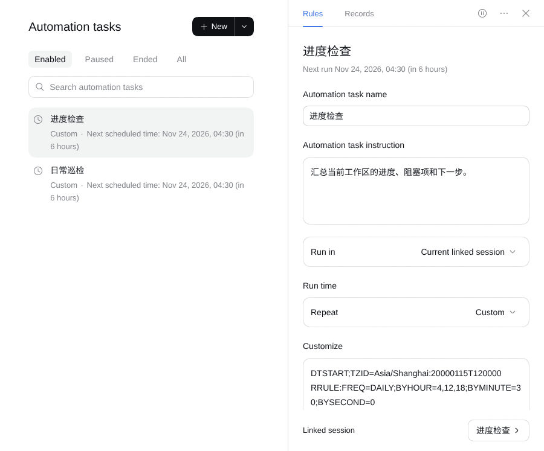

<p align="center"></p>

<h1 align="center">DSH Schedule Model</h1>

<p align="center"><strong>在 DSH 对话里给定时任务选模型和思考等级，不改全局默认。</strong></p>

<p align="center"><a href="https://github.com/Sth32/dsh-schedule-model/releases/latest">安装包与发布说明</a> · <a href="package.json">DSH 兼容范围</a> · <a href="LICENSE">MIT</a></p>

> 每天上海时间 04:30、12:30、18:30 跑「进度检查」，用已配置的 BigFree，高思考。



<sub>DSH Web 实机：一条原生任务显示三个时刻和接收会话。演示使用模拟模型。v0.1.11 在 Web 0.2.2-rc.5 和 0.2.3-alpha.2 验证，GUI 截图来自后者。</sub>

## 1. 给 Schedule 加了什么

- **指定模型和思考等级**：任务照常出现在 DSH 原生「自动化任务」列表。
- **一天多个时刻只建一条任务**：默认继承当前工作目录，也可指定目录。
- **旧任务只换模型**：对每次新开会话的任务，保留原时间、目录、预设和运行历史。也可撤销覆盖，恢复原预设或默认模型。查询会区分配置来源、待投递和 DSH 已记录的实际请求。
- **在一个会话管理所有工作区**：可选的「定时任务管理」模式，集中查看当前、其他和未分组任务的模型配置；一次审批可为最多 10 条每次新开会话的既有任务设置、修改或撤销覆盖。

原生页面继续管理时间和运行记录；模型通过对话设置，不会在原生编辑页增加字段。复用会话的旧任务不自动迁移。**禁用或卸载插件前，先暂停依赖模型覆盖的任务**；原生任务不会随插件一起停。

## 2. 安装后怎么说

DSH Web（CLI）：

```sh
dsh plugin --profile web add https://github.com/Sth32/dsh-schedule-model.git
```

重启 DSH，选中工作区后，用开头的话术试建一条任务。

> 每天新加坡时间 04:30、12:30、18:30 用 BigFree、高思考做巡检，**每次新开会话**。

- **每次新开会话**：创建任务时不创建接收会话；执行时开新会话并使用任务指定的模型和思考等级。归档已完成的单次运行会话不影响后续计划。
- **复用会话（默认）**：创建时就建立一个专用接收会话，后续共用同一段历史。手动聊天或换模型会影响之后的定时运行；归档并停止该会话会删除绑定的活动任务。

可加一句「接收会话叫『巡检派单』」显式固定标题。未指定时，复用会话沿用任务名；每次新开的会话由 DSH 使用任务名和运行时间命名。已建会话不自动改名。

> 把已有的「值班巡检」换成 BigFree，低思考，其他不变。

> 撤销「值班巡检」的模型覆盖，恢复原预设。

> 查「进度检查」配置的模型和最近一次请求用的模型。

修改和撤销适用于**每次新开会话的任务**；不会迁移原本复用会话的任务。删除任务不会自动删除会话。首次验证：在「自动化任务」里找到对应任务，点「立即执行」，再回原对话查询模型。查询的是 DSH 记录的请求，不代表供应商最终实际使用的模型。

<details>
<summary>进阶：跨工作区管理和复用会话</summary>

在当前 DSH profile 的 `cordis.patch.yml` 中为插件加一次配置，重启后新开会话，选择「定时任务管理 / Schedule Management」。如果已有这一行的 `config`，只添加字段，保留原来的 `routes`。

```yaml
- id: schedule-model-natural
  config:
    managementPreset: schedule-model-management
```

> 看一下当前、其他工作区和未分组的定时任务分别配置了什么模型。

> 把「值班巡检」和「未分组周报」换成 BigFree，高思考；其他设置不变。

由 Agent 找任务，不用手抄 ID。用 DSH 确认卡核对这一批任务和模型后点「允许一次」。普通会话仍按原归属限制。只在当前 DSH Host 里操作，并将覆盖写入当前 profile；不会写入其他 profile 或机器。查询区分任务配置和原生默认；不把默认值冒充实跑。

对于复用会话的旧任务，也可直接说「把这条任务换成 BigFree，高思考」。DSH 会同时说明两条路，再仅对选中的方案发出一次审批：

- **改原会话**：保留原对话（DSH 切换模型时仍可能按原规则压缩上下文）；该会话后续对话和所有绑定到它的任务都换模型。原会话须已打开、空闲且预设兼容。保存设置不等于已跑通；旧历史过长或新模型窗口太小时，DSH 可能在首次请求拒绝切换。
- **新开专用会话**：只给这条任务换一次执行会话，后续继续复用新会话；不复制旧上下文。原任务 ID、规则和历史保留，旧会话和其他任务不动。

方案不可用会说明原因，不自动换成另一方案。未选择、取消或拒绝审批都不修改。

</details>

安装范围：DSH 0.2.x，自 0.2.2-rc.1 起，不含 0.3.0 预发布。允许安装不等于逐版实测。

[维护指南](docs/MAINTENANCE.md) · [测试指南](docs/TESTING.md)
